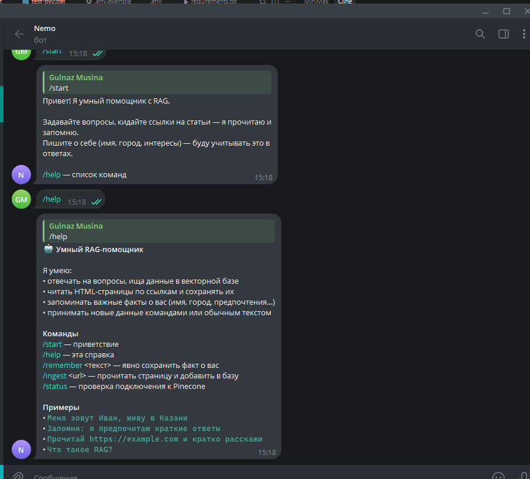
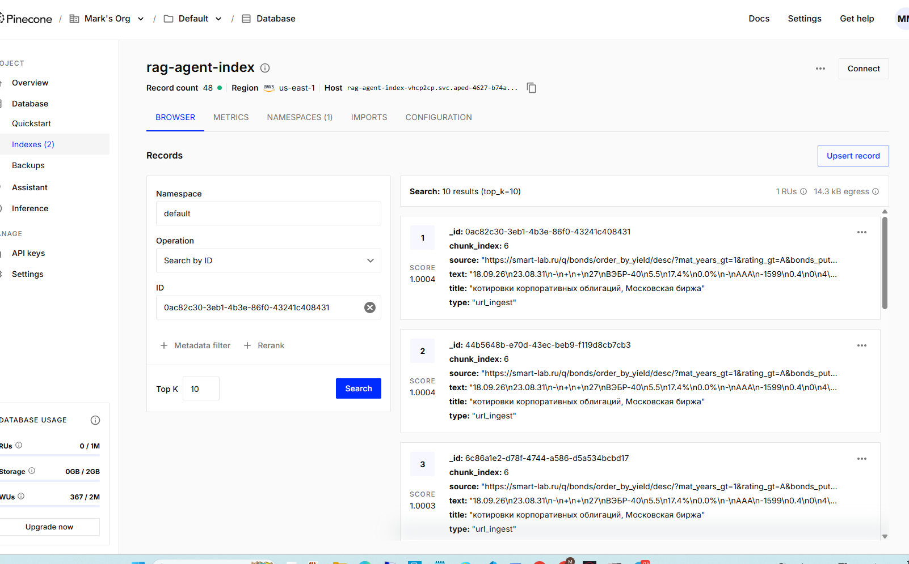

# Nemo Bot RAG — умный Telegram-помощник

RAG-агент + Telegram (PyTelegramBotAPI) + Pinecone + память о пользователе + инструменты (tools).




## Возможности

| Функция | Как работает |
|---------|----------------|
| **Ответы на вопросы** | Поиск в Pinecone → LLM (OpenAI-compatible `base_url`) |
| **Чтение URL** | Эвристика / `/ingest` → HTML → чанки → эмбеддинги → Pinecone |
| **Память о пользователе** | Эвристики (имя, город, работа, «запомни…») → эмбеддинги в Pinecone |
| **Добавление данных** | Ссылки, `/remember`, `/ingest`, обычный текст с фактами |
| **Tools** | `get_russian_corporate_bond_fact` (реальный API русской Википедии), `get_weather_stub`, `search_web_stub` |
| **Защита от 409** | Файловый лок на процесс — Telegram разрешает только одного `getUpdates`-поллера на токен |

## Требования

- Python **3.10+**
- Ключи: OpenAI-совместимый API, Pinecone, токен бота от [@BotFather](https://t.me/BotFather)

## Структура

```
nemo-bot-RAG/
├── bot.py            # Telegram-интерфейс (точка входа)
├── rag_agent.py      # OOP RAG-агент + self-test
├── memory.py         # эвристическая память пользователя
├── url_ingestor.py   # парсинг HTML-ссылок
├── tools.py          # @tool: Wikipedia API + заглушки
├── config.py         # env-конфиг (dataclass + validate)
├── __init__.py       # пакетные экспорты
├── start.bat         # оркестратор запуска для Windows
├── requirements.txt
├── .env.example
└── screenshots/      # скриншоты бота и индекса
```

## Быстрый старт (Windows)

```bat
cp .env.example .env
:: Заполните OPENAI_*, PINECONE_*, TELEGRAM_BOT_TOKEN

start.bat
```

Скрипт `start.bat` выполняет 4 фазы и логирует всё в `deploy.log`:

```
[1/4] STOP   — остановка старых процессов (.nemo_bot.pid + wmic по bot.py)
[2/4] CLEAN  — удаление только известных cache-артефактов
[3/4] BUILD  — проверка Python 3.10+ → venv → pip install -r requirements.txt
[4/4] START  — импорт-проверка модулей → запуск bot.py
```

Флаги `start.bat`:

| Флаг | Действие |
|------|----------|
| `--no-cache` | Пропустить очистку кэша |
| `--rebuild` | Пересоздать venv с нуля |
| `--dry-run` | Показать действия без деструктивных операций |
| `--foreground` | Запуск в foreground (режим по умолчанию, `Ctrl+C` для остановки) |
| `-h`, `--help` | Справка |

Проверка без побочных эффектов: `start.bat --dry-run`

## Ручной запуск (любая ОС)

```bash
python -m venv .venv
source .venv/bin/activate   # Windows: .venv\Scripts\activate
pip install -r requirements.txt
python bot.py
```

## Переменные окружения

```env
OPENAI_API_KEY=...
OPENAI_BASE_URL=https://api.openai.com/v1   # поддерживается любой совместимый прокси
OPENAI_MODEL=gpt-4o-mini
OPENAI_EMBEDDING_MODEL=text-embedding-3-small

PINECONE_API_KEY=...
PINECONE_INDEX_NAME=rag-agent-index
PINECONE_NAMESPACE=default
PINECONE_DIMENSION=1536
PINECONE_CLOUD=aws
PINECONE_REGION=us-east-1

TELEGRAM_BOT_TOKEN=123456:ABC-DEF...

# Опционально LangSmith
# LANGSMITH_TRACING=true
# LANGSMITH_API_KEY=...
```

## Команды в Telegram

| Команда | Описание |
|---------|----------|
| `/start` | Приветствие |
| `/help` | Справка |
| `/remember <текст>` | Явно сохранить факт |
| `/ingest <url>` | Прочитать страницу в базу |
| `/status` | Проверка Pinecone |

Бот отвечает и на обычный текст: факты о себе извлекаются автоматически, ссылки — читаются сами.

Примеры сообщений:

- `Меня зовут Иван, живу в Казани`
- `Запомни: предпочитаю краткие ответы`
- `Прочитай https://docs.langchain.com и кратко расскажи`
- `Что такое RAG?`

## Self-test агента (без Telegram)

```bash
python rag_agent.py
```

Проверяет подключение к Pinecone и эмбеддинги, затем выполняет тестовый поиск.

## Данные в Pinecone

Все записи лежат в одном индексе и различаются по метаданным `type`:

| `type` | Что хранит |
|--------|-----------|
| `url_ingest` | Чанки прочитанных страниц (`source`, `chunk_index`, `title`) |
| `user_memory` | Факты о пользователе (`user_id`, `category`, `created_at`) |

## Troubleshooting

**`terminated by other getUpdates request` (409)** — запущено больше одного экземпляра бота. Остановите лишние процессы: бот сам держит файловый лок и завершается с понятной ошибкой, если другой экземпляр уже работает. Также помогает удаление застрявшего webhook — скрипт делает `delete_webhook(drop_pending_updates=True)` перед стартом поллинга.

**`OPENAI_API_KEY is not set` / `PINECONE_API_KEY is not set`** — не заполнен `.env`.

**Подробнее про `start.bat`** — см. [`summary.startbat.md`](summary.startbat.md).
